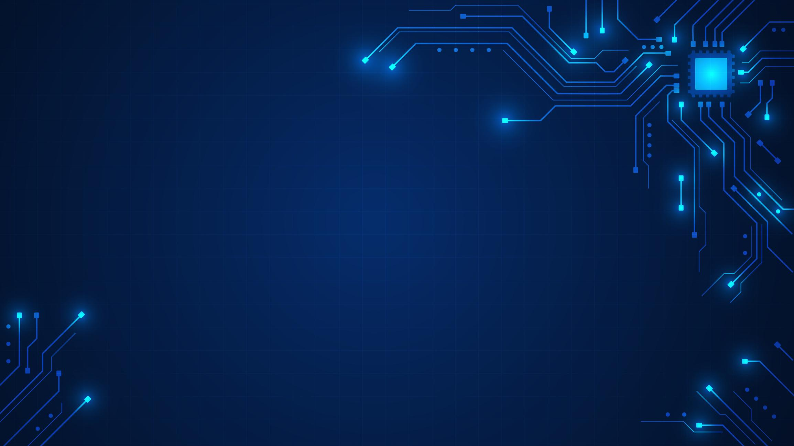
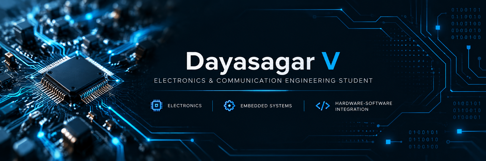

# Dayasagar V

**Electronics & Communication Engineering Student**

Interested in Electronics, Embedded Systems & Hardware–Software Integration.

---

## About Me

I'm an Electronics and Communication Engineering student at Sai Vidya Institute of Technology, Bengaluru.

I'm interested in understanding how electronic hardware and software work together to solve practical problems.

- 🎓 Electronics & Communication Engineering
- 🔌 Focus: Electronics and Embedded Systems
- 🕹️ Exploring game development with Unity
- 🛠️ Learning through practical projects

## Skills & Tools

- Git and GitHub
- Unity

## Projects

### Oil Safety AI

An oil-and-gas safety project focused on exploring safety information and potential risk patterns.

[View Repository](https://github.com/dayasagar514-ctrl/oil-safety-ai)

## Currently Learning

- Electronics and embedded systems
- Practical engineering and development skills

## Connect

[GitHub Profile](https://github.com/dayasagar514-ctrl)

---

*Learn consistently. Build practically. Improve every day.*
